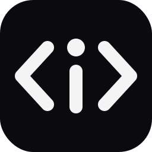

<p align="center"></p>

<h1 align="center">Syntax Explainer</h1>

<p align="center">
  <b>Pasa el ratón sobre una palabra clave y entiende qué hace, en español.</b><br>
  Tu compañero para aprender a programar en VS Code y Cursor.
</p>

<p align="center">
  
  
  
  
  
  
  
</p>

<p align="center">
  
  
  
</p>

---

## ✨ Características

- 💬 **Explicaciones en español** claras y pensadas para principiantes, en una o dos frases.
- 🤝 **No sustituye nada:** el hover normal (tipos, firmas, documentación) sigue apareciendo y la explicación se añade al lado.
- 🌍 **20 lenguajes y formatos + React, Vue y Angular**, con **2270 explicaciones:** JavaScript, TypeScript, React, Vue, Angular, HTML, CSS, PHP, Python, Java, C#, C, C++, Go, Rust, Kotlin, Swift, Dart, Bash, SQL, JSON, YAML y Markdown.
- 📚 **Más que palabras clave:** métodos (`map`, `filter`, `push`…), funciones integradas (`len`, `array_map`, `malloc`…), hooks, directivas, propiedades CSS, unidades, tipos utilitarios de TypeScript y comandos de terminal.
- 🎯 **Inteligente:** solo palabras completas, ignora cadenas y comentarios, sin distinguir mayúsculas en SQL y HTML, entiende `#include`, `println!`, `$HOME`, `v-if`, `*ngIf`, `@media` o `16px`, y en JSON/YAML solo explica claves de configuración conocidas.
- ✏️ **Fácil de ampliar:** un archivo JSON por lenguaje.
- 🪶 **Ligero y privado:** sin dependencias y sin conexión a internet; todo funciona en local.

## 🖱️ Ejemplo

Pasa el ratón sobre `function` en un archivo JavaScript:

```js
function saludar(nombre) {
  return `Hola, ${nombre}`;
}
```

Y verás, debajo del hover habitual:

```text
function saludar(nombre: any): string
────────────────────────────────────────
function — Declara una función: un bloque de código que puedes ejecutar.
```

## 🌐 Lenguajes soportados

| | Lenguaje | IDs de VS Code | Entradas |
|:-:|---|---|:-:|
| 🟨 | JavaScript | `javascript` (+ base de TS, JSX, Vue) | **211** |
| 🟦 | TypeScript | `typescript`, `typescriptreact` (+ JS) | **59** |
| ⚛️ | React / JSX | `javascriptreact`, `typescriptreact` | **78** |
| 🟩 | Vue | `vue` (+ JS + HTML) | **48** |
| 🅰️ | Angular | `typescript`, `html` | **73** |
| 🔁 | RxJS | `javascript`, `typescript`, `jsx`, `tsx` | **44** |
| 🟧 | HTML | `html`, `vue` | **158** |
| 🎨 | CSS | `css`, `scss`, `less` | **180** |
| 🐘 | PHP | `php` | **156** |
| 🐍 | Python | `python` | **149** |
| ☕ | Java | `java` | **149** |
| 🟪 | C# | `csharp` | **96** |
| 🔧 | C | `c`, `cpp` | **77** |
| ➕ | C++ | `cpp` (+ C) | **61** |
| 🐹 | Go | `go` | **72** |
| 🦀 | Rust | `rust` | **84** |
| 🟣 | Kotlin | `kotlin` | **78** |
| 🍎 | Swift | `swift` | **77** |
| 🎯 | Dart / Flutter | `dart` | **77** |
| 🐚 | Bash / Shell | `shellscript` | **75** |
| 🗄️ | SQL | `sql` | **135** |
| 📦 | JSON (claves de package.json, tsconfig…) | `json`, `jsonc` | **41** |
| ⚙️ | YAML (GitHub Actions, Docker Compose, Kubernetes) | `yaml` | **40** |
| 📝 | Markdown | `markdown` | **22** |
| | **Total** | | **2172** |

> [!NOTE]
> Kotlin, Swift, Dart, Vue y Rust necesitan que tengas instalada la extensión de ese lenguaje para que el editor reconozca los archivos.

## 📦 Instalación

### Desde las tiendas

| Tienda | Enlace |
|---|---|
| 🟦 Visual Studio Marketplace (VS Code) | _próximamente_ |
| 🟪 Open VSX (Cursor, VSCodium, Windsurf…) | _próximamente_ |

Cuando esté publicada, busca **Syntax Explainer** en la vista de extensiones (`Ctrl+Shift+X` / `Cmd+Shift+X`) e instálala.

### Desde un archivo `.vsix`

1. Descarga `syntax-explainer-0.3.0.vsix` desde las [releases del repositorio](https://github.com/GALLEGOOOO/syntax-explainer/releases).
2. Abre la Paleta de comandos (`Ctrl+Shift+P` / `Cmd+Shift+P`).
3. Ejecuta **`Extensions: Install from VSIX...`** y elige el archivo.
4. Recarga la ventana si te lo pide. ¡Listo! 🎉

> [!TIP]
> Funciona igual en **Cursor** y en **VS Code**.

## ⚙️ Ajustes

| Ajuste | Tipo | Por defecto | Descripción |
|---|:-:|---|---|
| `syntaxExplainer.enabled` | `boolean` | `true` | Activa o desactiva las explicaciones. |

## ✏️ Añadir palabras

Cada diccionario tiene su archivo en `src/keywords/<nombre>.json` (`angular`, `c`, `cpp`, `csharp`, `css`, `dart`, `go`, `html`, `java`, `javascript`, `json`, `kotlin`, `markdown`, `php`, `python`, `react`, `rust`, `rxjs`, `shellscript`, `sql`, `swift`, `typescript`, `vue`, `yaml`):

```json
{
  "function": "Declara una función: un bloque de código que puedes ejecutar."
}
```

- 🔡 En **SQL** y **HTML** escribe la palabra en minúsculas.
- ➖ En **CSS** se admiten guiones, `@` y `:` (`justify-content`, `@media`, `:hover`).
- 💲 En **PHP** y **Bash** puedes incluir `$` (`$this`, `$HOME`, `$#`).
- #️⃣ En **C/C++** las directivas llevan `#` (`#include`); en **Rust** las macros llevan `!` (`println!`).
- 🔗 Algunos lenguajes combinan diccionarios (TS = JS + TypeScript + Angular + RxJS, Vue = JS + HTML + Vue, C++ = C + C++); gana el más específico.
- 🧰 También puedes añadir entradas en bloque: `node tools/add.js <nombre> < lista.txt` (una línea `palabra|texto` por entrada).

Después:

```bash
npm test              # comprueba que todo está bien
npx @vscode/vsce package
```


## ❓ Preguntas frecuentes

<details>
<summary><b>¿Por qué no veo la explicación en un comentario o en un texto?</b></summary>

Es a propósito: la extensión ignora cadenas y comentarios (con una detección sencilla por línea).
</details>

<details>
<summary><b>Tengo dos explicaciones repetidas</b></summary>

Probablemente tienes instalada otra copia o una versión antigua con otro identificador. Desinstálala: el identificador actual es <code>GALLEGOSSJ.syntax-explainer</code>.
</details>

<details>
<summary><b>¿En HTML sale la explicación sobre texto normal?</b></summary>

Sí, en HTML las palabras coinciden en cualquier parte del archivo (por ejemplo, «a» en una frase). Lo mejoraremos en próximas versiones.
</details>

<details>
<summary><b>¿Por qué en un archivo TypeScript aparecen explicaciones de Angular?</b></summary>

Los términos de Angular (<code>ngOnInit</code>, <code>Component</code>, <code>signal</code>…) se aplican a todos los archivos TypeScript y HTML, porque el editor no distingue un proyecto Angular de otro. Tienen la prioridad más baja, así que nunca tapan una explicación de JavaScript o TypeScript.
</details>

## 🤝 Contribuir

¿Falta una palabra, una explicación no es clara o has encontrado un error? ¡Toda ayuda es bienvenida!

- 💡 **Proponer palabras o mejoras:** abre un [issue](https://github.com/GALLEGOOOO/syntax-explainer/issues/new) indicando el lenguaje, la palabra y la explicación que propones.
- 🛠️ **Enviar un pull request:**
  1. Haz un fork de [GALLEGOOOO/syntax-explainer](https://github.com/GALLEGOOOO/syntax-explainer).
  2. Añade o corrige entradas en `src/keywords/<lenguaje>.json`.
  3. Ejecuta `npm test` para comprobar que todo está bien.
  4. Abre el pull request explicando qué has cambiado.
- ✍️ **Estilo de las explicaciones:** español claro y pensado para principiantes, una o dos frases, terminadas en punto y, sobre todo, correctas.

## 📜 Licencia

[MIT](LICENSE) © GALLEGOSSJ · Código en [GitHub](https://github.com/GALLEGOOOO/syntax-explainer) · Cambios en el [CHANGELOG](CHANGELOG.md)

---

<p align="center">
  Hecho con ❤️ por <b>GALLEGOSSJ</b> · Licencia MIT
</p>
